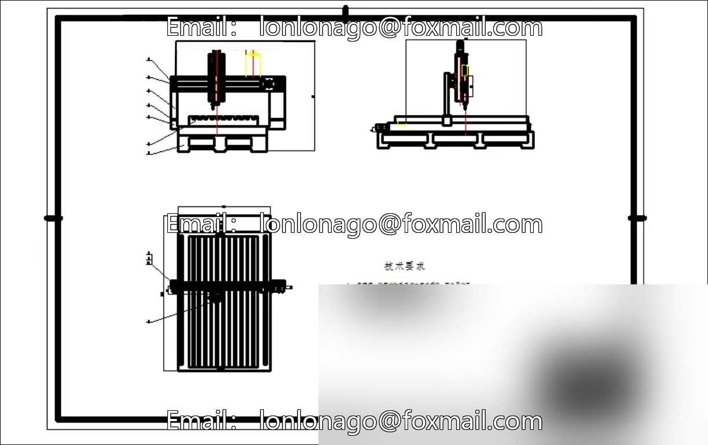

# 111  CNC high-pressure water jet cutting machine design; cutting machine design drawing; high-pressure water jet cutting machine design

## Body

111  CND High Pressure Water Jet Cutting Machine Design  Water Jet Cutting Machine Design Chart  Water Jet Cutting Machine Design CAD Chart  Water Cut Design
The main design of the CND High Pressure Water Jet cutting machine mainly designs its mechanical part. It mainly includes the vertical feed mechanism, the design of the horizontal feed mechanism, and the selection of servo motors and ball screws as tasks. This cutting machine can complete the cutting of flat board materials.

The design covers CNC high-pressure water jet cutting machines, water jet cutting design plans, water jet cutting CAD diagrams, and water blade design; the images show technical requirements, a paper completion document, CAD tools and overall/vertical drawings.

<!-- AI_ENRICHED -->

## Images

## Payment

Here is a pay link on Stripe ( https://buy.stripe.com/3cs8yP7sY87d0vu9AB ). Please contact me lonlonago@foxmail.com after funding $89, and I will send you a complete data files , thank you!

